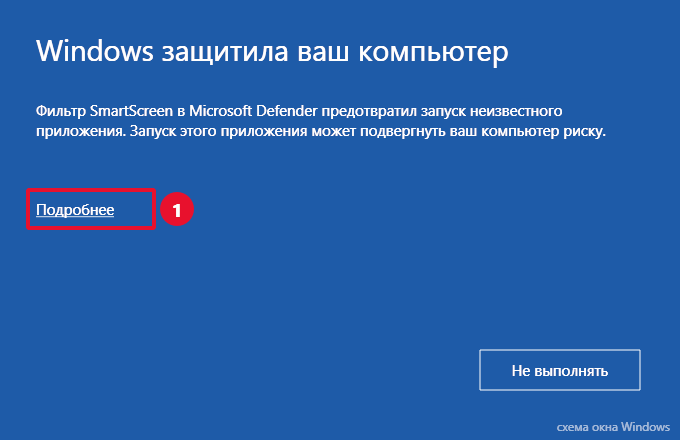
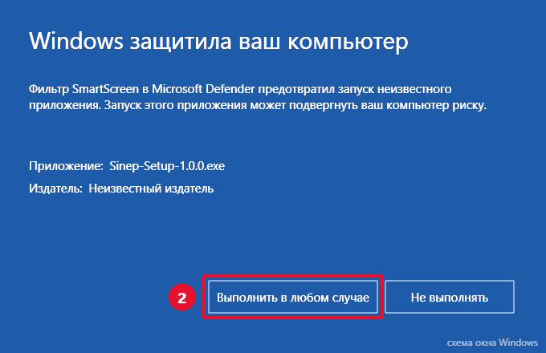
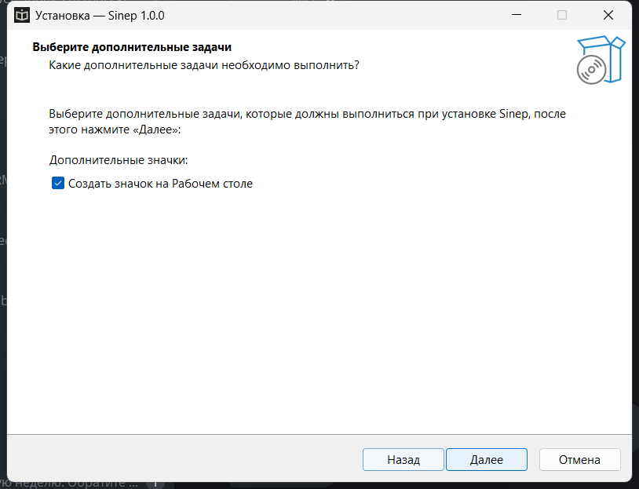

# Как установить Sinep

Sinep — программа для репетиторов: ученики, расписание, оплаты и домашние задания. Работает на Windows 10 и 11.
Основная часть бесплатна; аналитика, отчёт для родителей и расширенное оформление — по подписке (1000 ₽ в месяц).

## Sinep для Android

Есть версия для телефона (Android 9 и новее). Последняя версия всегда по этой ссылке:
https://github.com/ohaYoshi/sinep-releases/releases/download/android-latest/Sinep-Android.apk Откройте его на телефоне и разрешите установку из этого источника. Подписка одна
на компьютер и телефон. Данные на телефоне хранятся только в приложении и удаляются вместе с ним.

## 1. Скачайте установщик

Скачивайте Sinep **только отсюда**:
- GitHub: https://github.com/ohaYoshi/sinep-releases/releases/latest
- Яндекс.Диск: https://disk.yandex.ru/d/NnIwCJK_d-EmLA

Файл называется `Sinep-Setup-<версия>.exe`, весит около 27 МБ.

Браузер может написать, что файл «обычно не скачивают» или «может быть опасен». Так браузеры встречают любую новую
программу. Нажмите «Сохранить» или «Всё равно сохранить» (в Chrome и Яндекс Браузере — через значок загрузок
или «⋯» рядом с файлом).

## 2. Запустите установщик и разрешите запуск

У Sinep пока нет платного сертификата Microsoft, поэтому при первом запуске Windows покажет синее окно
«Windows защитила ваш компьютер». Это не вирус: Windows так предупреждает обо всех программах, которые ещё мало
кто скачивал.

**Нажмите «Подробнее»:**



**Затем «Выполнить в любом случае»:**



Если кнопки «Выполнить в любом случае» нет, запуск неизвестных программ запрещён настройками компьютера
(так бывает на рабочих и школьных компьютерах). Поставьте Sinep на свой домашний компьютер.

## 3. Установите

Права администратора не нужны: программа ставится только для вас. Нажимайте «Далее», при желании отметьте
«Создать значок на Рабочем столе», в конце — «Завершить».



Sinep появится в меню «Пуск». Обновление ставится так же, поверх старой версии: данные сохраняются.

## Как убедиться, что файл настоящий

Мы публикуем контрольную сумму SHA-256 каждого установщика рядом со ссылкой на скачивание.
Чтобы сверить её, откройте папку с файлом, нажмите правой кнопкой по пустому месту → «Открыть в терминале»
и введите:

```
Get-FileHash .\Sinep-Setup-<версия>.exe
```

Строка в столбце `Hash` должна совпасть с опубликованной. Если не совпадает — не запускайте файл и напишите нам.

## Безопасность

- Скачивайте Sinep только по ссылкам выше. Других официальных источников нет; «взломанные» и «бесплатные полные»
  версии на других сайтах — подделки, в них может быть вирус.
- Подписку оплачивают только по ссылке, которую мы присылаем с адреса sinepsupport@gmail.com, на странице
  платёжного сервиса. Мы никогда не просим данные карты в письме или в программе.
- Ваши данные (ученики, оплаты, задания) хранятся только на вашем компьютере. Мы их не видим.

## Удаление

«Параметры» → «Приложения» → Sinep → «Удалить». Данные остаются в папке `%APPDATA%\Sinep`, их можно удалить вручную
или оставить на случай повторной установки. Резервную копию можно сделать заранее: «Настройки» → «Экспорт в файл…».

## Документы

Публичная оферта, политика конфиденциальности и согласие на обработку персональных данных — ссылки в закреплённом
посте Telegram-канала https://t.me/sinepp. Те же документы открываются в программе: «Поддержка» → «Документы».

Вопросы: sinepsupport@gmail.com
